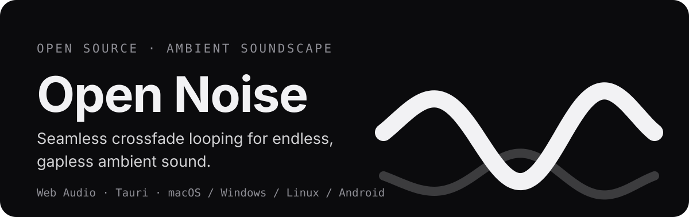
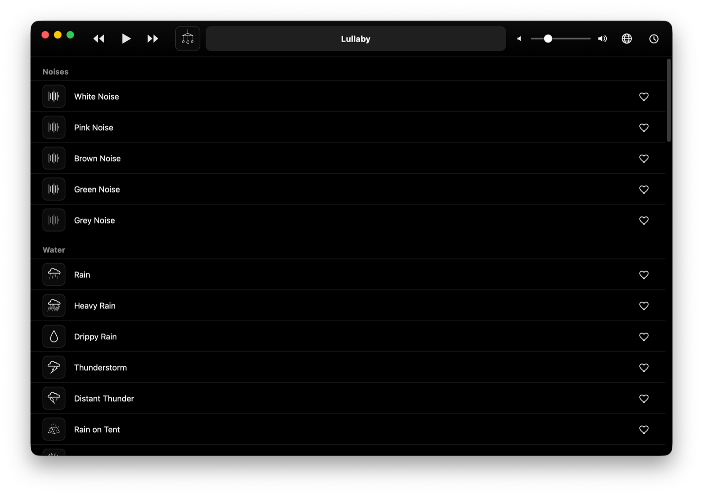
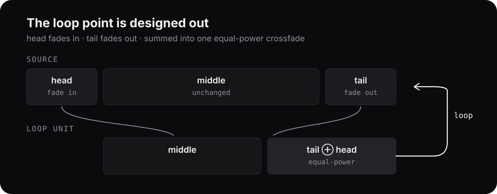

<p align="center">
  
</p>

<p align="center">
  <b>English</b> | <a href="./README.zh-CN.md">简体中文</a>
</p>

<p align="center">
  
</p>

## What is Open Noise?

Open Noise is an open source ambient soundscape player. It loops environmental
sounds endlessly and seamlessly, so you can focus, relax, or fall asleep
without ever hearing where a recording starts over.

The engine, the catalog, and the desktop app are all in this repository. The UI
stays deliberately quiet: a black and white interface, one waveform, and
nothing that competes with the sound.

## Why the loops sound continuous

Most loop players replay a file from the top and hope you do not notice. Open
Noise designs the loop point out of the audio:

<p align="center">
  
</p>

1. Every file is split into **head**, **middle** and **tail**.
2. The head is faded in and the tail is faded out, sample by sample
   (linear or exponential gain).
3. Head and tail are summed into one **equal-power crossfade** region.
4. The player loops `middle + crossfade` forever. The seam is inaudible.

The DSP core is plain, pure TypeScript. No Web Audio objects, no DOM, fully
unit tested. Sounds that have a strong opening (like colored noises) instead
start at a random offset, so the beginning is never recognizable either.

## Features

- **54-sound catalog** across 9 categories: Noises, Water, Appliances, Nature,
  Fire, Vehicles, Urban, Sleepy, Classics
- **Seamless looping** with per-sample fade curves and equal-power crossfade
- **Random start** for continuous-spectrum sounds
- **Sleep timer** with a gentle fade-out before it stops
- **Favorites**, volume control, and now-playing info in the toolbar
- **English and Simplified Chinese**, switchable in the app
- **Everything unlocked**: no accounts, no paywall, no telemetry
- **macOS desktop app** (Apple Silicon) built with Tauri, plus a plain web app

## Getting started

You need [Node.js](https://nodejs.org) 18+. For the desktop app, also install
[Rust](https://rustup.rs) and the Xcode Command Line Tools (macOS).

```bash
git clone https://github.com/Praying/open-noise.git
cd open-noise
npm install
```

Run the web app:

```bash
npm run dev
```

Build and run the macOS app:

```bash
npx tauri dev      # development window
npx tauri build --target aarch64-apple-darwin --bundles app
```

The packaged app lands in
`src-tauri/target/aarch64-apple-darwin/release/bundle/macos/Open Noise.app`.


## Project structure

```text
src/audio/      Loop engine: fade curves, segmentation, loop buffer, mixer, timer
src/domain/     Noise model and sound catalog
src/catalog/    Catalog data (54 entries, 9 categories)
src/ui/         Toolbar, list, icons
src/i18n.ts     English and Simplified Chinese strings
src-tauri/      Tauri desktop shell (macOS today, Windows / Linux / Android next)
design/         Icon source (SVG)
```

## Roadmap

- Windows, Linux and Android packages (the Tauri shell is already in place)
- Custom audio import with seamless looping
- Multi-track mixes with per-track volume (mixer core is implemented and tested)
- Theme selection and animated catalog icons

## Development

```bash
npm test        # 67 unit tests (Vitest)
npx tsc --noEmit
npm run build   # production web bundle in dist/
```

Tests cover the parts that must not drift: fade mathematics, loop segmentation,
crossfade continuity, mixing, timers, catalog integrity and localization.

## License

[MIT](./LICENSE) © 2026 Praying
