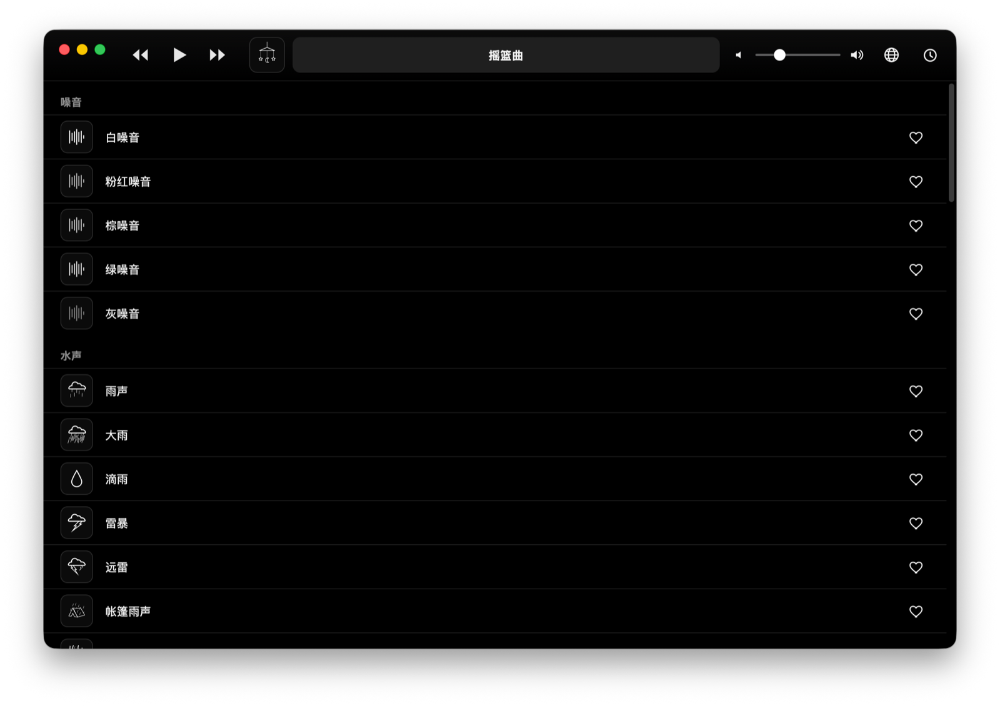

<p align="center">
  
</p>

<p align="center">
  <a href="./README.md">English</a> | <b>简体中文</b>
</p>

<p align="center">
  
</p>

## Open Noise 是什么?

Open Noise 是一款开源环境音播放器。它以无缝循环持续播放自然与环境声,适合专注、
放松或入睡,你永远听不出录音是从哪里重新开始的。

引擎、目录与桌面应用全部开源。界面刻意保持安静:黑白配色、一条声波线,没有任何
与声音争夺注意力的元素。

## 为什么循环听不出接缝

多数循环播放器只是从头重放文件,寄望于你察觉不到。Open Noise 把循环点从音频中
"设计掉":

<p align="center">
  
</p>

1. 每个文件被切成 **head**、**middle**、**tail** 三段。
2. head 淡入、tail 淡出,逐样本施加增益曲线(线性或指数)。
3. head 与 tail 叠加为一个**等功率交叉淡化**区。
4. 播放器永远循环 `middle + 交叉淡化区`,接缝不可闻。

DSP 核心是纯 TypeScript:不触碰 Web Audio 对象、不依赖 DOM,全程单元测试。
对于开头特征明显的彩色噪音,则从随机偏移开始播放,同样听不出起点。

## 功能

- **54 个声音目录**,覆盖 9 个分类:噪音、水声、电器、自然、火、交通、城市、睡眠、经典
- **无缝循环**:逐样本淡变曲线 + 等功率交叉淡化
- **随机起点**:连续频谱声音不暴露开头
- **睡眠定时器**:结束前柔和渐弱
- **收藏**、音量控制、工具栏正在播放显示
- **中英双语**,应用内一键切换
- **全部解锁**:无账号、无付费墙、无遥测
- **macOS 桌面应用**(Apple Silicon,Tauri 打包),以及纯 Web 版

## 快速开始

需要 [Node.js](https://nodejs.org) 18+。构建桌面应用另需 [Rust](https://rustup.rs)
与 Xcode 命令行工具(macOS)。

```bash
git clone https://github.com/Praying/open-noise.git
cd open-noise
npm install
```

运行 Web 版:

```bash
npm run dev
```

构建并运行 macOS 应用:

```bash
npx tauri dev      # 开发窗口
npx tauri build --target aarch64-apple-darwin --bundles app
```

打包产物位于
`src-tauri/target/aarch64-apple-darwin/release/bundle/macos/Open Noise.app`。


## 项目结构

```text
src/audio/      循环引擎:淡变曲线、分段、循环缓冲、混音、定时器
src/domain/     噪音模型与声音目录
src/catalog/    目录数据(54 项,9 个分类)
src/ui/         工具栏、列表、图标
src/i18n.ts     中英文案
src-tauri/      Tauri 桌面壳(现已支持 macOS,Windows / Linux / Android 路线中)
design/         图标源稿(SVG)
```

## 路线图

- Windows、Linux、Android 打包(Tauri 壳已就绪)
- 自定义音频导入并无缝循环
- 多轨混音与每轨音量(混音核心已实现并通过测试)
- 主题切换与目录动态图标

## 开发

```bash
npm test        # 67 个单元测试(Vitest)
npx tsc --noEmit
npm run build   # 生产构建,输出至 dist/
```

测试覆盖绝不容出错的部分:淡变数学、循环分段、交叉淡化连续性、混音、定时器、
目录完整性与本地化。

## 许可证

[MIT](./LICENSE) © 2026 Praying
